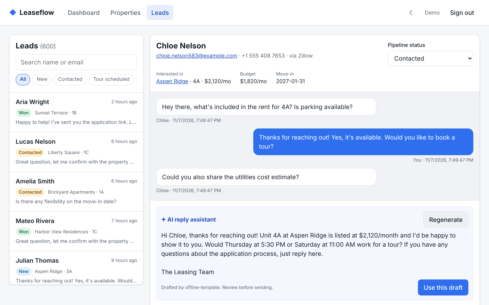
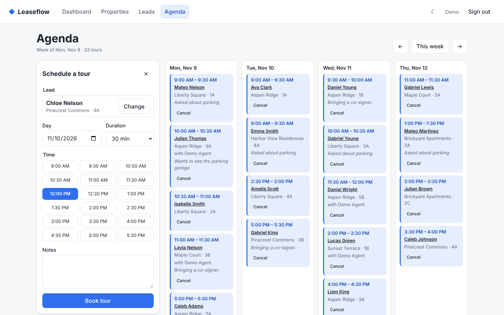
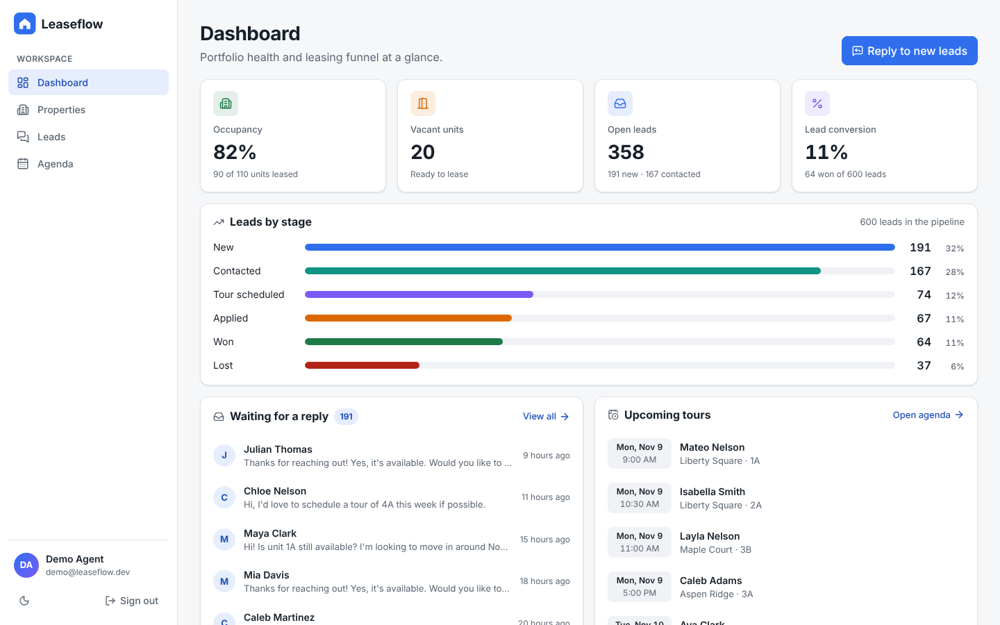
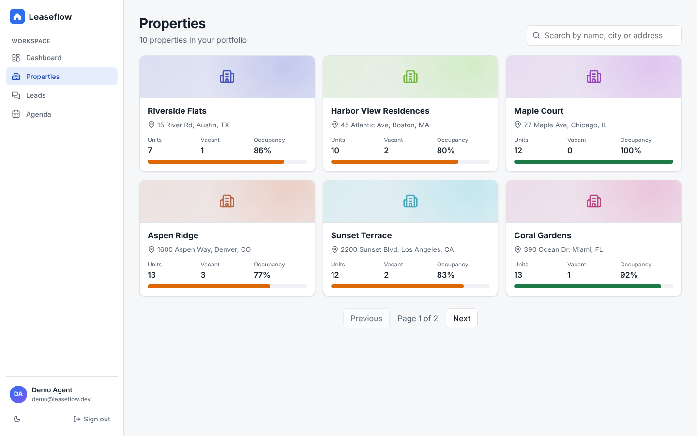
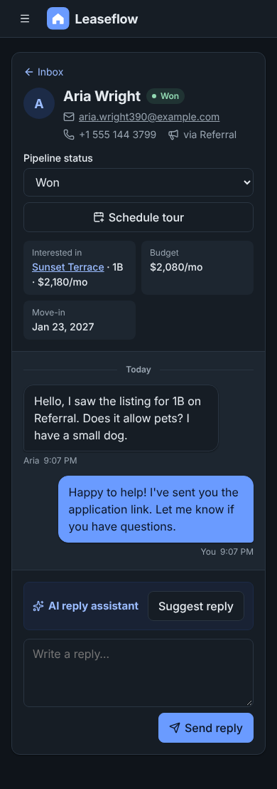

# Leaseflow

A leasing dashboard for property managers: properties and units, a leads inbox for prospective tenants, an AI assistant that drafts replies to leads in real time, and a tour agenda to book visits without double booking.

It is a full-stack monorepo (React 19 + TypeScript on the frontend, Django + Django Ninja on the backend) built in one sitting as a portfolio project for a React role in the proptech space. The [timeline](#timeline) section shows how it was built, commit by commit.


*A new lead → AI-drafted reply streamed token by token → reply sent → tour booked from the lead page.*

| Lead detail + AI assistant | Tour agenda | Dashboard |
| --- | --- | --- |
|  |  |  |
| **Properties** | **Inbox on mobile, dark mode** | |
|  |  | |

---

## Contents

- [Live demo](#live-demo)
- [Quick start](#quick-start)
- [Features](#features)
- [Architecture](#architecture)
- [Backend](#backend)
- [Frontend](#frontend)
- [AI reply assistant](#ai-reply-assistant)
- [Testing](#testing)
- [Containers and environments](#containers-and-environments)
- [CI](#ci)
- [Deploy](#deploy)
- [React concepts demonstrated](#react-concepts-demonstrated)
- [Key decisions and trade-offs](#key-decisions-and-trade-offs)
- [Timeline](#timeline)
- [What I would do next](#what-i-would-do-next)

---

## Live demo

- App: _link added after the first Render deploy_
- API docs: _link added after the first Render deploy_
- Login: **`demo` / `leaseflow123`**

Hosted on Render's free tier, so the API sleeps after 15 idle minutes and the first request can take about a minute.

---

## Quick start

### With Docker (recommended)

```bash
cp .env.example .env        # optional: add ANTHROPIC_API_KEY
docker compose up --build
```

- App: http://localhost:5173
- API docs (OpenAPI / Swagger, generated by Django Ninja): http://localhost:8000/api/docs
- Demo login: **`demo` / `leaseflow123`**

The backend container runs migrations and seeds a deterministic demo dataset (10 properties, 110 units, 600 leads, ~1,500 messages, ~70 tours over the next two weeks) on start.

### Without Docker

Requirements: Python 3.13 + [uv](https://docs.astral.sh/uv/), Node 22 + pnpm 10.

```bash
# backend (SQLite by default, set DATABASE_URL for Postgres)
cd backend
uv sync
uv run python manage.py migrate
uv run python manage.py seed_demo
uv run uvicorn config.asgi:application --reload --port 8000

# frontend (in another terminal); Vite proxies /api to :8000
cd frontend
pnpm install
pnpm dev
```

### AI assistant

Without `ANTHROPIC_API_KEY`, the assistant streams a deterministic template reply, so the demo and every test work offline. Set the key (and optionally `ANTHROPIC_MODEL`, default `claude-opus-5-5`) to get real drafts from Claude.

---

## Features

| Screen | What it does |
| --- | --- |
| **Login** | JWT sign-in with client-side validation; returns you to the page you originally asked for. |
| **Dashboard** | Occupancy, vacant units, open leads, conversion rate and a leads-by-stage funnel that links into the filtered inbox. |
| **Properties** | Responsive card grid with debounced search and pagination, both kept in the URL. |
| **Property detail** | Units table and an "add unit" form; adding a unit refreshes counts on the detail, the list and the dashboard through cache invalidation. |
| **Leads inbox** | Two-pane inbox (list + nested detail route) over 600 leads, virtualized, with status filters and search in the URL. One pane at a time on mobile. |
| **Lead detail** | Conversation thread, optimistic pipeline status, a reply composer with the streaming AI assistant, and a "Schedule tour" shortcut. |
| **Agenda** | Week of tours (week in the URL) and a booking form: pick a lead, a day, a duration and a free slot. Slots already taken for that unit or by you are disabled; the server still rejects overlaps with a 409. New and canceled tours update optimistically. |

---

## Architecture

```text
Browser ──► nginx (prod) / Vite dev server
              │  static SPA            │  /api/* (proxied, no CORS, SSE unbuffered)
              ▼                        ▼
        React 19 SPA            uvicorn (ASGI) ── Django + Django Ninja (async views)
                                       │                 │
                                       ▼                 ▼
                                  PostgreSQL       Anthropic API (streaming)
```

```text
.
├── backend/              Django project (uv)
│   ├── config/           settings, urls, NinjaAPI composition, exception mapping
│   ├── core/             shared: domain exceptions, pagination, Page/ErrorOut schemas, LLM adapter
│   ├── accounts/         JWT auth
│   ├── properties/       properties and units
│   ├── leads/            leads, messages, AI reply assistant, seed_demo command
│   ├── dashboard/        read-only metrics across apps
│   ├── visits/           tour scheduling with overlap detection
│   └── tests/
├── frontend/             Vite + React 19 + TypeScript (pnpm)
│   └── src/
│       ├── app/          store, router, providers, layout
│       ├── features/     auth, properties, leads, dashboard, assistant, visits
│       ├── shared/       api, auth, ui, hooks, lib, theme
│       └── test/         MSW server/handlers, fixtures, renderApp()
├── compose/              Dockerfile per service (+ nginx config, entrypoint)
├── docker-compose*.yml   one compose file per environment (dev is the default)
├── render.yaml           Render blueprint (API + Postgres + static site)
├── .github/workflows/    CI
└── docs/                 demo GIF, screenshots, planning board
```

The API contract is defined once on the server with Pydantic schemas (Django Ninja) and published as OpenAPI at `/api/openapi.json`. The frontend mirrors those schemas in `shared/api/types.ts`.

---

## Backend

**Stack:** Django 6, Django Ninja (async endpoints, Pydantic schemas, automatic OpenAPI), async ORM, PostgreSQL (SQLite fallback), PyJWT, uvicorn, Anthropic Python SDK. Managed with uv; linted and formatted with ruff.

### Five layers per app

Every Django app follows the same layout:

| Layer | File | Responsibility |
| --- | --- | --- |
| Models | `models.py` | Tables and choices. |
| Schemas | `schemas.py` | The HTTP contract (Pydantic): request validation and response shape. |
| Repositories | `repositories.py` | The only place that touches the ORM (`afirst`, `acount`, async iteration, annotations). |
| Services | `services.py` | Business rules. Call repositories, raise domain errors, never import HTTP types. |
| Routers | `routers.py` | Thin Ninja endpoints: parse input, call one service, return. |

Rules that keep the layers honest:

- **Errors cross the boundary once.** Services raise `core.exceptions.NotFoundError` / `AuthenticationError`; a single handler in `config/api.py` turns them into HTTP responses. Services stay testable without a request.
- **One owner per table.** `dashboard` has no models and reads through the `properties` and `leads` repositories instead of querying their models.
- **External providers behind an adapter.** Only `core/llm.py` knows the Anthropic SDK; `leads/services.py` builds the prompt.

### Endpoints

| Method | Path | Notes |
| --- | --- | --- |
| POST | `/api/auth/login` | Returns an access + refresh token pair. |
| POST | `/api/auth/refresh` | Rotates the pair. |
| GET | `/api/auth/me` | Current user. |
| GET / POST | `/api/properties` | Paginated, searchable list with occupancy stats / create. |
| GET | `/api/properties/{id}` | Property with its units. |
| POST | `/api/properties/{id}/units` | Create a unit. |
| GET | `/api/leads?status=&search=` | Inbox rows with a last-message preview (one subquery, no N+1). |
| GET / PATCH | `/api/leads/{id}` | Lead with conversation / change pipeline status. |
| POST | `/api/leads/{id}/messages` | Agent reply. The first reply moves a `new` lead to `contacted`. |
| POST | `/api/leads/{id}/reply-suggestion` | AI-drafted reply streamed as Server-Sent Events. |
| GET | `/api/visits?start=&end=` | Tours overlapping a time range (canceled hidden unless `include_canceled`). |
| POST | `/api/visits` | Book a tour. `409` with the conflicting visit if the unit or the agent is already booked; `400` in the past; max 2 hours. Moves a new/contacted lead to `tour_scheduled`. |
| PATCH | `/api/visits/{id}` | Cancel or complete a tour (a closed tour can't be reopened). |
| GET | `/api/dashboard` | Occupancy and funnel metrics. |

### Auth

Short-lived access token (30 min) and longer refresh token (7 days), both JWT with a `type` claim so a refresh token can never be used as an access token. Authentication is an **async** `HttpBearer`, so protected async views never block the event loop.

---

## Frontend

**Stack:** React 19, TypeScript, Vite 8 with the React Compiler, React Router, Redux Toolkit + RTK Query, React Hook Form + Zod, CSS Modules on design tokens, Vitest + Testing Library + MSW, oxlint.

### Folders by feature

```text
src/
├── app/                     composition only
│   ├── store.ts             configureStore + makeStore() factory (isolated store per test)
│   ├── router.tsx           composes each feature's routes under RequireAuth + Layout
│   ├── providers.tsx        Redux, Theme and Auth providers (shared with tests)
│   └── Layout.tsx
├── features/
│   ├── auth/                LoginPage, routes
│   ├── properties/          propertiesApi, PropertiesPage, PropertyDetailPage, AddUnitForm, routes
│   ├── leads/               leadsApi, LeadsInboxPage, LeadDetailPage, LeadStatusSelect, ReplyComposer, routes
│   ├── dashboard/           dashboardApi, DashboardPage, routes
│   ├── assistant/           useReplySuggestion (streaming), index.ts
│   └── visits/              visitsApi, AgendaPage, ScheduleVisitForm, scheduleReducer, dates, routes
└── shared/
    ├── api/                 baseApi (RTK Query + token refresh), config, types
    ├── auth/                tokenStorage, AuthContext, RequireAuth, authApi
    ├── ui/                  Spinner, StateViews, StatusBadge, Pagination, VirtualList<T>
    ├── hooks/               useDebounce
    ├── lib/                 SSE parser, formatters
    └── theme/               ThemeContext, tokens.css
```

**Boundaries are enforced by the linter** (`.oxlintrc.json`), not just by convention:

- a feature imports another feature only through its `index.ts` (e.g. `leads` uses `@/features/assistant`);
- `shared/` never imports from `features/` or `app/`.

Each feature exports its own `routes.tsx` with lazy-loaded pages, so every screen is its own chunk and `app/router.tsx` only composes them.

### State: where each kind of state lives

| Kind | Where | Why |
| --- | --- | --- |
| Server state (properties, leads, metrics) | RTK Query cache | Caching, request deduplication, tag invalidation, optimistic updates. |
| Session (user, status) | `AuthContext` | Read by many components, changes rarely. |
| Tokens | `tokenStorage` external store + `useSyncExternalStore` | Must be readable outside React (the RTK Query base query refreshes tokens). |
| Theme | `ThemeContext` | Global, low-frequency. |
| Filters, search, page | URL (`useSearchParams`) | Shareable, survives reloads and back/forward. |
| Form state | React Hook Form + Zod | Uncontrolled inputs, schema as the single source of truth. |
| Local UI (draft text, suggestion stream) | `useState` / `useReducer` | Owned by one component. |
| Multi-field form with dependent fields (tour booking) | `useReducer` | Changing the lead, the day or the duration can invalidate the picked slot; the reducer resets it in one place instead of in effects. |
| In-flight changes (new or canceled tour, lead status) | `useOptimistic` | Shown instantly, dropped automatically when the transition ends. |

There is no hand-written Redux slice on purpose: once server data is in RTK Query and filters are in the URL, no shared client state is left. The store is ready for one (`combineSlices`) when it appears.

---

## AI reply assistant

1. The agent clicks **Suggest reply** on a lead.
2. The frontend `POST`s to `/api/leads/{id}/reply-suggestion` with `fetch` and reads `response.body` as a stream (EventSource can't send `POST` or an `Authorization` header).
3. The backend service builds a prompt from facts in the database only (lead, unit, rent, conversation) and streams Claude's output through an async generator wrapped in a `StreamingHttpResponse`, as SSE frames: `delta` → `done` | `error`.
4. An incremental SSE parser (`shared/lib/sse.ts`) handles frames split across network chunks.
5. A reducer with a discriminated union (`idle | streaming | done | error`) renders the text token by token. **Stop** aborts the request with an `AbortController`, which also runs on unmount and when the lead changes.
6. The agent reviews the draft, clicks **Use this draft**, edits it if needed and sends. The message is stored with `ai_generated = true`, shown as "AI-assisted" in the thread.

The system prompt keeps the model honest: no invented fees, amenities or discounts; same language as the prospect; always end with a next step. nginx is configured with `proxy_buffering off` for `/api` so tokens reach the browser as they are generated.

---

## Testing

| Suite | Tools | Count | What it covers |
| --- | --- | --- | --- |
| Backend | pytest, pytest-django, pytest-asyncio | 41 | Auth contract, async endpoints, validation errors, SSE frames, service rules without HTTP. Runs on SQLite locally and Postgres in CI/Docker. |
| Frontend | Vitest, Testing Library, user-event, MSW | 32 | User flows through the real router and store, plus unit tests for hooks, the SSE parser and the reducer. |

Frontend flow tests render the real route tree with `renderApp(path)` and an isolated store; MSW mocks the network at the `fetch` level, including a streamed SSE response. Queries are by role and label, the same way a user or screen reader finds things.

Covered flows: redirect to login and back, form validation, bad credentials, sign out; debounced search and pagination in the URL; error state with retry; the inbox renders only a window of rows out of 300; status filter in the URL; AI suggestion streamed into the draft and sent flagged as AI-assisted; provider error; optimistic status update with rollback on a 500; booking a tour (optimistic card, then the saved one), slots disabled by existing tours, a 409 conflict clearing the picked slot, optimistic cancel with rollback.

```bash
cd backend && uv run pytest -q
cd frontend && pnpm test          # or: pnpm coverage
docker compose -f docker-compose.test.yml run --rm backend-tests
docker compose -f docker-compose.test.yml run --rm frontend-tests
```

---

## Containers and environments

Image definitions live in `compose/`; the compose files sit at the repository root so commands stay short.

```text
compose/
├── backend/Dockerfile        targets: dev (uv, hot reload) and prod (runtime deps only, non-root)
├── backend/entrypoint.sh     migrate (+ seed when SEED_DEMO=true), then exec the server
├── frontend/Dockerfile       targets: dev (Vite HMR) and prod (static build on nginx)
└── frontend/nginx.conf       SPA fallback, long-cache hashed assets, /api proxy with SSE unbuffered
docker-compose.yml            dev: Postgres + Django (reload) + Vite, source mounted as volumes
docker-compose.prod.yml       Postgres + Django (uvicorn workers) + nginx on :8080, healthchecks
docker-compose.test.yml       lint + tests for both apps against an in-memory Postgres
.env.example                  copy to .env (git-ignored)
```

```bash
docker compose up --build                                   # dev
docker compose -f docker-compose.prod.yml up --build -d     # prod-like, http://localhost:8080
docker compose -f docker-compose.test.yml run --rm backend-tests
```

---

## CI

`.github/workflows/ci.yml` runs on every pull request and on `main`:

- **backend:** `ruff check`, `ruff format --check`, migration drift check, pytest against a Postgres service container;
- **frontend:** oxlint (including the architecture boundaries), `tsc`, Vitest with coverage, production build;
- **docker:** builds the production images once both suites pass.

---

## Deploy

`render.yaml` is a [Render Blueprint](https://render.com/docs/blueprint-spec) for the free tier:

| Resource | What it runs |
| --- | --- |
| `leaseflow-db` | PostgreSQL |
| `leaseflow-api` | The production backend image (`compose/backend/Dockerfile`): migrates, seeds the demo data once, serves uvicorn. Health check on `/api/health`. |
| `leaseflow-web` | `pnpm build` served as a static site on Render's CDN, with an SPA rewrite and immutable caching for hashed assets. |

No URL is hard-coded: the blueprint hands the API's host to the frontend build (`VITE_API_HOST`) and the site's host to Django's CORS list (`FRONTEND_HOST`). Secrets are generated by Render, and `ANTHROPIC_API_KEY` is entered in the dashboard (`sync: false`), never committed.

To deploy your own copy: Render dashboard → **New → Blueprint** → pick this repository → fill in `ANTHROPIC_API_KEY` (or leave it empty for the offline assistant) → **Apply**.

---

## React concepts demonstrated

Mapped to the requirements of the role:

| Requirement | Where to look |
| --- | --- |
| **Hooks and modern patterns** | `useReducer` + discriminated union in `features/assistant/useReplySuggestion.ts` and `features/visits/scheduleReducer.ts` (dependent form fields); custom hooks `useDebounce`, `useReplySuggestion`; `useLayoutEffect` + `ResizeObserver` in `VirtualList`; `useSyncExternalStore` in `AuthContext`; effects only for syncing with external systems (DOM theme, timers, aborting fetches), derived state computed during render. |
| **Context API** | Auth split into a state context and an actions context so buttons that only call `logout` don't re-render when the user changes; `ThemeContext`; React 19 `<Context value>` and `use(Context)`. |
| **TypeScript with React** | Generic `VirtualList<T>`; discriminated unions for auth state, the suggestion stream and send results; prop unions (`StatusBadge`); types inferred from Zod schemas; `as const` tuples to derive `LeadStatus`; typed Redux hooks with `withTypes`. |
| **Redux Toolkit / RTK Query** | `shared/api/baseApi.ts` (re-auth wrapper with a single in-flight refresh), `injectEndpoints` per feature, `providesTags` / `invalidatesTags`, optimistic `updateQueryData` with `undo()` on failure, `upsertQueryData`, `makeStore()` factory. |
| **Performance** | React Compiler (automatic memoization) instead of hand-written `useMemo`/`useCallback`; windowed list (300–600 leads, ~20 rows in the DOM); route-level code splitting with `lazy` + `Suspense`; vendor chunks; debounced queries; RTK Query deduplication and caching. |
| **React 19** | `useOptimistic` + `useTransition` for the lead status and for canceling tours; form `action` + `useActionState` for sending replies and booking tours, where the action pushes an optimistic card into the parent's `useOptimistic` list; `use(Context)`; Context as a provider. |
| **Testing (Jest-compatible)** | Vitest + Testing Library + user-event + MSW, role-based queries, fake timers for the debounce hook, network-level mocks including streaming. |
| **HTML5 / CSS3, responsive** | Mobile-first CSS Modules on CSS variables, Grid and Flexbox, two-pane inbox that collapses to one pane on mobile, dark mode via token swap, `color-mix`, `dvh`. |
| **Accessibility** | Skip link, semantic landmarks, labelled form fields with `aria-invalid` / `aria-describedby`, `role="alert"` for errors, `role="log"` for the conversation, `aria-live` for the streamed draft, `aria-pressed` filter chips in a `fieldset`, `aria-setsize` / `aria-posinset` in the virtual list, keyboard-focusable scroll region, `prefers-reduced-motion`. |
| **Vite / bundling** | Vite 8 config with the React Compiler Babel preset, dev proxy, `manualChunks`, environment variables (`VITE_API_URL`), path alias, Vitest config in the same file. |
| **LLM APIs, Docker, CI** | Streaming Claude integration, multi-stage Dockerfiles, compose per environment, GitHub Actions. |

---

## Key decisions and trade-offs

- **Django Ninja over DRF.** Async views, Pydantic validation and OpenAPI out of the box, with much less code. The API docs at `/api/docs` double as the contract for the frontend.
- **Hand-rolled JWT instead of an auth package.** About 40 lines with an explicit contract (token types, TTLs, refresh). In production I'd consider httpOnly cookies for the refresh token to reduce XSS exposure; it's a deliberate simplification here.
- **SSE over `fetch` instead of WebSockets.** The stream is one-directional and short-lived, it works through standard HTTP proxies, and `fetch` lets us send `POST` with an `Authorization` header.
- **Offline fallback for the LLM.** Demos, CI and tests never depend on a third-party API or a secret.
- **RTK Query instead of a hand-written slice.** The app is mostly server state; RTK Query covers caching, invalidation and optimistic updates. Filters go in the URL rather than Redux so they are linkable.
- **A small custom `VirtualList`** instead of a library: fixed row height is enough here, and it shows the technique. For variable heights I'd use TanStack Virtual.
- **oxlint instead of ESLint.** It ships with the current Vite template, is much faster, and supports the `no-restricted-imports` overrides used for the architecture boundaries.
- **CSS Modules + tokens instead of a UI kit.** Full control of semantics and accessibility, and dark mode is a variable swap.

---

## Timeline

Built on Saturday, 2026-11-07 (times in UTC), starting from an empty repository at 19:15:

| Time | Commit |
| --- | --- |
| 19:30 | Backend scaffold: Django + Ninja, async JWT auth |
| 19:30 | Leasing domain: properties, units, leads, messages, SSE AI endpoint, seed data |
| 19:30 | Backend tests (22) |
| 19:37 | Backend refactor into apps with five layers (models, schemas, repositories, services, routers) |
| 19:42 | Frontend: feature-based architecture, RTK Query, auth, all screens, streaming assistant |
| 19:43 | Frontend tests: Vitest + Testing Library + MSW (21) |
| 19:48 | `compose/` Dockerfiles and dev / prod / test stacks (compose files later moved to the root) |
| 19:51 | CI and screenshots |
| 20:10 | Visits app: tour scheduling with overlap detection (409), 10 backend tests |
| 20:14 | Agenda + booking form: `useReducer`, form action + `useActionState`, `useOptimistic`, 11 frontend tests |
| 20:15 | Render blueprint (API + Postgres + static site) |
| 20:20 | Demo GIF and README |

`git log --reverse --format="%ad %s" --date=iso` shows the exact history.

---

## What I would do next

- Agent assignment and per-agent availability in the agenda (the API already blocks double-booking an agent).
- Generate `shared/api/types.ts` from the Ninja OpenAPI schema with `openapi-typescript`, so the contract can't drift.
- Real-time inbox updates (new leads) over SSE or WebSockets.
- E2E tests with Playwright and an axe accessibility check in CI.
- Refresh token in an httpOnly cookie, rate limiting on login and on the AI endpoint.
- LangSmith (or OpenTelemetry) tracing for the assistant, plus an eval set for reply quality.

## License

MIT, see [LICENSE](LICENSE).
